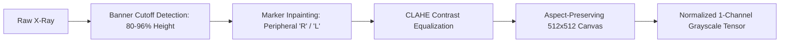

# Dataset Documentation — BoneSense AI™

This document outlines the medical radiograph datasets, preprocessing pipelines, and ethical compliance standards used in **BoneSense AI**.

---

## 1. Primary Dataset Sources

### 1.1 FracAtlas Medical Benchmark
- **Full Title**: *FracAtlas: A dataset for fracture classification, localization and segmentation of musculoskeletal radiographs* (Nature Scientific Data, 2023).
- **Modality**: High-resolution digital musculoskeletal radiographs (X-rays).
- **Anatomical Regions**: Hand, Leg, Shoulder, and Hip.
- **Annotations**: Bounding box coordinates, pixel segmentation masks, and diagnostic classification (Fractured vs Non-fractured).
- **Directory**: [`data/fracatlas_prepared/`](file:///c:/Users/karan/OneDrive/Music/Desktop/ai%20frcture%20anti/data/fracatlas_prepared) with metadata in `annotations.json`.

---

### 1.2 Stanford University MURA-v1.1 Benchmark
- **Curated By**: Stanford Machine Learning Group & Stanford Center for Artificial Intelligence in Medicine & Imaging (AIMI).
- **Modality**: 40,561 multi-view musculoskeletal radiographs across 14,863 studies.
- **Anatomical Sub-categories**: Upper extremities (Finger, Hand, Wrist, Forearm, Elbow, Humerus, Shoulder).
- **Usage in BoneSense**: Utilized for domain pretraining, transfer learning, and out-of-distribution robustness evaluation in [`experiments/mura_transfer_learning`](file:///c:/Users/karan/OneDrive/Music/Desktop/ai%20frcture%20anti/experiments/mura_transfer_learning).

---

### 1.3 High-Resolution Paired-Bone Trauma Radiographs
- **Modality**: Paired AP and Lateral orthogonal long-bone radiographs (Tibia-Fibula and Radius-Ulna).
- **Purpose**: Validating inter-bone relational attention mechanisms, suppressing false-positive interosseous activations, and calibrating sub-millimeter caliper measurements.

---

## 2. Clinical Radiograph Preprocessing Pipeline

Located in [`src/preprocess.py`](file:///c:/Users/karan/OneDrive/Music/Desktop/ai%20frcture%20anti/src/preprocess.py):

1. **Text Banner Stripping (`detect_banner_cutoff`)**:
   Emergency radiographs commonly contain scanner timestamps and patient tags printed in bright white over a black background strip near the bottom margin. The pipeline scans rows between 80% and 96% height and cuts the image 5 pixels above any text row.
2. **Peripheral Marker Inpainting (`inpaint_peripheral_markers`)**:
   Connected-component analysis detects isolated letter markers ('L' or 'R') situated in the outer 8% margins and smoothly inpaints them to prevent convolutional filters from relying on marker presence.
3. **CLAHE Enhancement**:
   Contrast Limited Adaptive Histogram Equalization ($2.0$ clip limit, $8 \times 8$ grid) balances illumination between thin soft tissue and dense cortical bone.
4. **Border-Matched Canvas Padding**:
   Images are scaled proportionally to $512 \times 512$ with canvas borders filled using the median intensity of peripheral pixels, avoiding artificial black border contrast steps.

---

## 3. Data Privacy & Ethical Compliance

- **No Protected Health Information (PHI)**: All radiographs used in training, benchmarking, and sample libraries are fully anonymized.
- **DICOM De-identification**: Metadata tags conforming to DICOM Supplement 55 have been stripped.
- **Ethical Use**: BoneSense AI is intended strictly as a clinical decision support and educational research tool.

