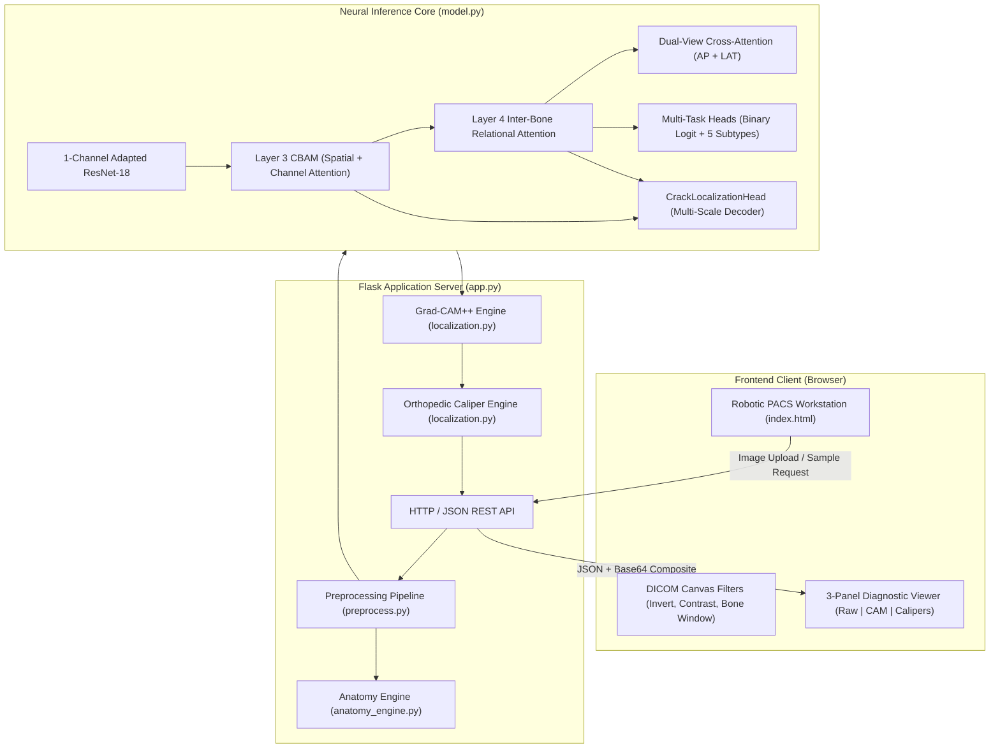

# System Architecture — BoneSense AI™

This document outlines the end-to-end hardware, software, and neural network architecture powering **BoneSense AI**.

---

## 1. High-Level Architectural Diagram

---

## 2. Neural Network Core (`DualBoneFractureNetwork`)

The core architecture is defined in [`src/model.py`](file:///c:/Users/karan/OneDrive/Music/Desktop/ai%20frcture%20anti/src/model.py):

### 2.1 Single-Channel Radiographic Adaptation
Standard torchvision backbones expect 3-channel RGB imagery. BoneSense AI modifies `conv1` (`Conv2d(1, 64, kernel_size=7, stride=2, padding=3, bias=False)`) by taking the mean of pretrained ImageNet weights across the channel dimension:
$$\mathbf{W}_{\text{adapted}} = \frac{1}{3} \sum_{c=1}^{3} \mathbf{W}_{\text{orig}}[:, c, :, :]$$

### 2.2 Convolutional Block Attention Module (CBAM)
Embedded after Layer 3 (256 channels, $32 \times 32$ spatial resolution):
1. **Channel Attention**: Captures feature importance via MaxPool and AvgPool shared MLP projections:
   $$\mathbf{M}_c(\mathbf{F}) = \sigma\left(\mathbf{W}_1(\delta(\mathbf{W}_0(\text{AvgPool}(\mathbf{F})))) + \mathbf{W}_1(\delta(\mathbf{W}_0(\text{MaxPool}(\mathbf{F}))))\right)$$
2. **Spatial Attention**: Gathers channel statistics and applies a $7 \times 7$ convolution with replicate padding to avoid edge artifacts:
   $$\mathbf{M}_s(\mathbf{F}) = \sigma\left(f^{7 \times 7}([\text{AvgPool}(\mathbf{F}); \text{MaxPool}(\mathbf{F})])\right)$$

### 2.3 Inter-Bone Relational Attention
Embedded after Layer 4 (512 channels, $16 \times 16$ spatial resolution):
Models spatial dependencies between adjacent parallel bones (e.g., Tibia & Fibula, Metatarsals). It computes a scaled dot-product attention matrix across flattened spatial positions $(H \times W)$:
$$\mathbf{A} = \text{Softmax}\left(\frac{\mathbf{Q} \mathbf{K}^T}{\sqrt{d_k}}\right), \quad \mathbf{Y} = \gamma (\mathbf{V} \mathbf{A}^T) + \mathbf{X}$$
where $\gamma$ is a learnable scaling factor initialized to zero.

### 2.4 Dual-View Cross-Attention
When dual-view radiographs (AP and Lateral projections) are provided, features from both views are extracted independently and fused using bilateral cross-attention, allowing features in the AP view to query corresponding depths in the Lateral view.

### 2.5 Multi-Task Clinical Heads
- **Binary Fracture Detection Head**: $\text{Linear}(128 \to 1)$ logit evaluated via Sigmoid.
- **Subtype Head**: $\text{Linear}(128 \to 5)$ predicting 5 distinct fracture patterns:
  1. *Hairline / Fissure (Minor crack)*
  2. *Transverse / Oblique (Linear break)*
  3. *Comminuted (Multi-fragment)*
  4. *Greenstick (Incomplete bending)*
  5. *Dislocation / Severe Displacement*
- **Crack Localization Head (`CrackLocalizationHead`)**: Multi-scale decoder fusing Layer 3 ($32 \times 32$) and Layer 4 ($16 \times 16$) features to produce a continuous $64 \times 64$ fracture probability map.

---

## 3. Specialized Anatomy Classification Engine

Located in [`src/anatomy_engine.py`](file:///c:/Users/karan/OneDrive/Music/Desktop/ai%20frcture%20anti/src/anatomy_engine.py):
- **Input**: 128-dimensional shared feature embedding from the backbone.
- **Layers**: Linear(128 $\to$ 128) $\to$ BatchNorm1d $\to$ ReLU $\to$ Dropout(0.25) $\to$ Linear(128 $\to$ 64) $\to$ BatchNorm1d $\to$ ReLU $\to$ Dropout(0.15) $\to$ Linear(64 $\to$ 4).
- **Target Classes**: Shoulder, Leg, Hand, Hip.
- **Weight Footprint**: 109 KB checkpoint (`checkpoints/anatomy_classifier.pt`).
- **Anatomy Rules Engine**: Maps relative bounding box coordinates $(y_{\text{norm}}, x_{\text{norm}})$ to precise orthopedic terminology (e.g., *Clavicle & AC Joint*, *Femoral Neck*, *Diaphyseal Shaft*).

---

## 4. Biomechanical Orthopedic Calipers Engine

Located in [`src/localization.py`](file:///c:/Users/karan/OneDrive/Music/Desktop/ai%20frcture%20anti/src/localization.py):
1. **Parallel Bone Separation**: Otsu thresholding with vertical profile analysis detects parallel shafts and isolates the fractured cortex.
2. **Crack Line Extraction**: Morphological skeletonization and ridge detection extract the fissure path.
3. **Angulation Arc**: Principal Component Analysis (PCA) computes primary eigenvectors for proximal and distal bone fragments, deriving the true angular displacement ($\theta$ in degrees).
4. **Displacement Gap (mm)**: Measures maximum Euclidean distance between separated cortices multiplied by radiographic scale factor ($0.15\text{ mm/pixel}$).
5. **Caliper Overlay**: Renders green bounding box, red crack mark, concentric crosshairs, proximal/distal guideline axes, and displacement calipers.

---

## 5. Web PACS Integration (`src/app.py` & `templates/index.html`)

- **Backend**: Flask 3.x WSGI microframework.
- **Image Pipeline**: OpenCV and Pillow handle in-memory decoding and encoding directly to Base64 strings without intermediate disk writes.
- **Composite Diagnostic Canvas**: Emits an integrated 3-panel report:
  - Panel 1: Original radiograph with metadata.
  - Panel 2: Pinpoint Grad-CAM++ crack localization overlay.
  - Panel 3: Orthopedic telemetry canvas with calipers, angulation, gap, and anatomical region diagnosis.

